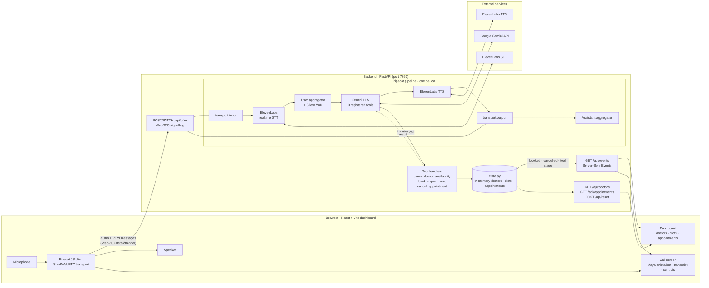
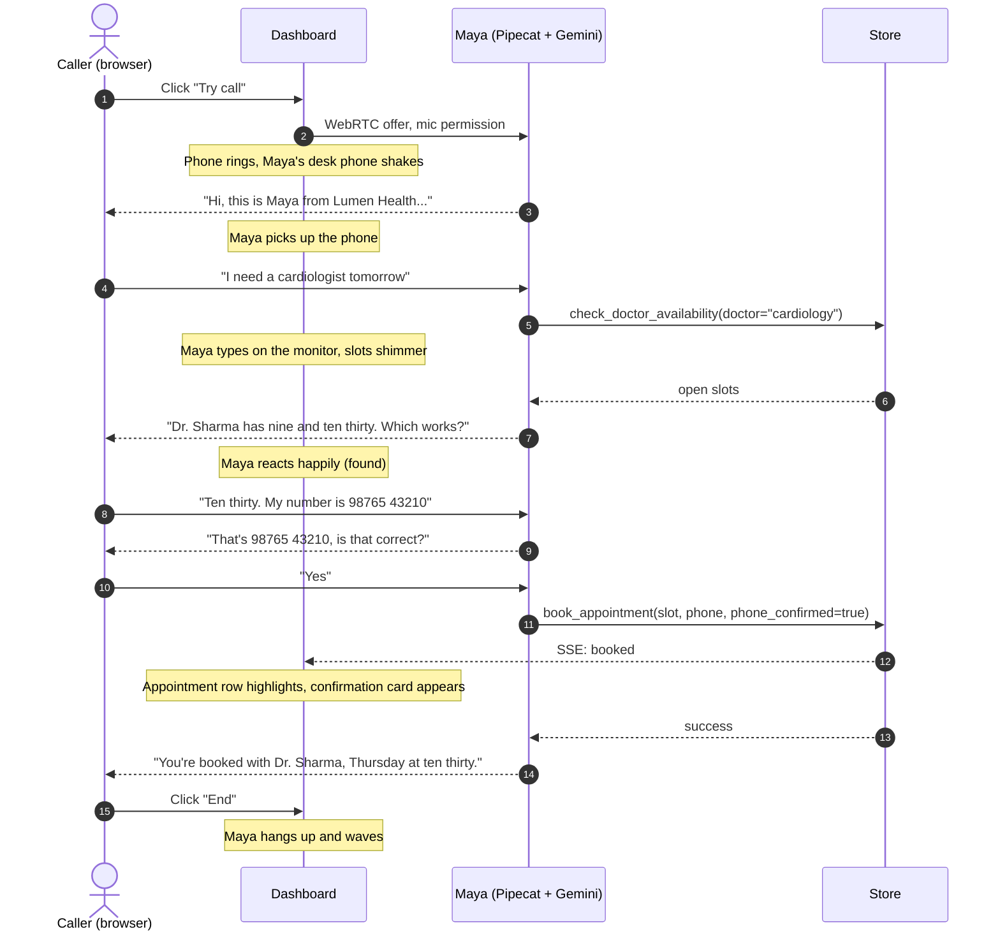
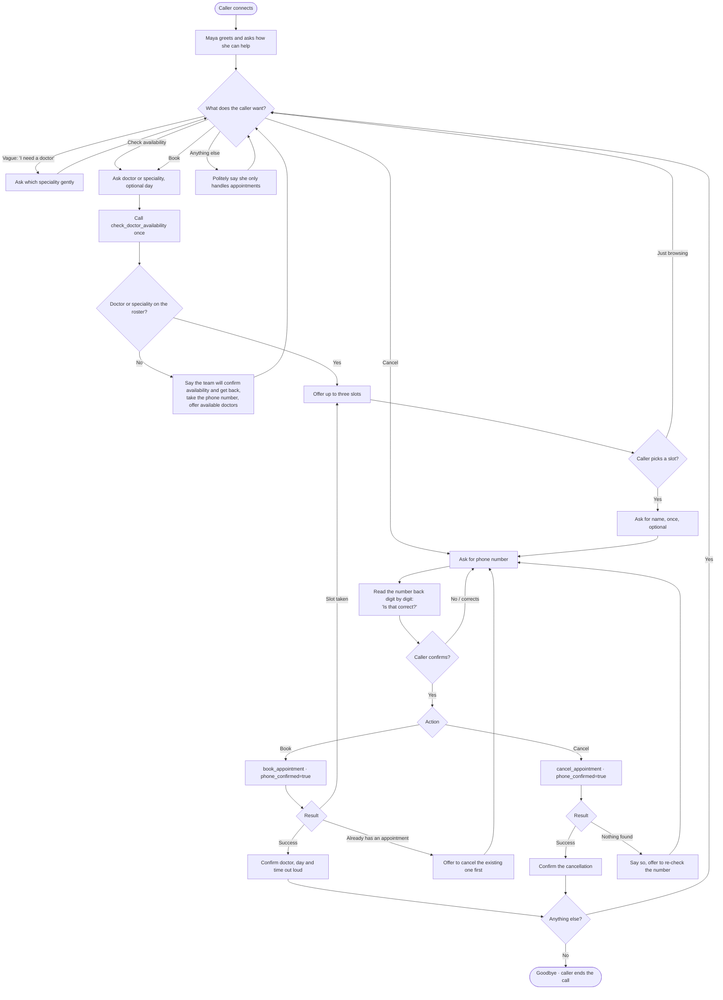
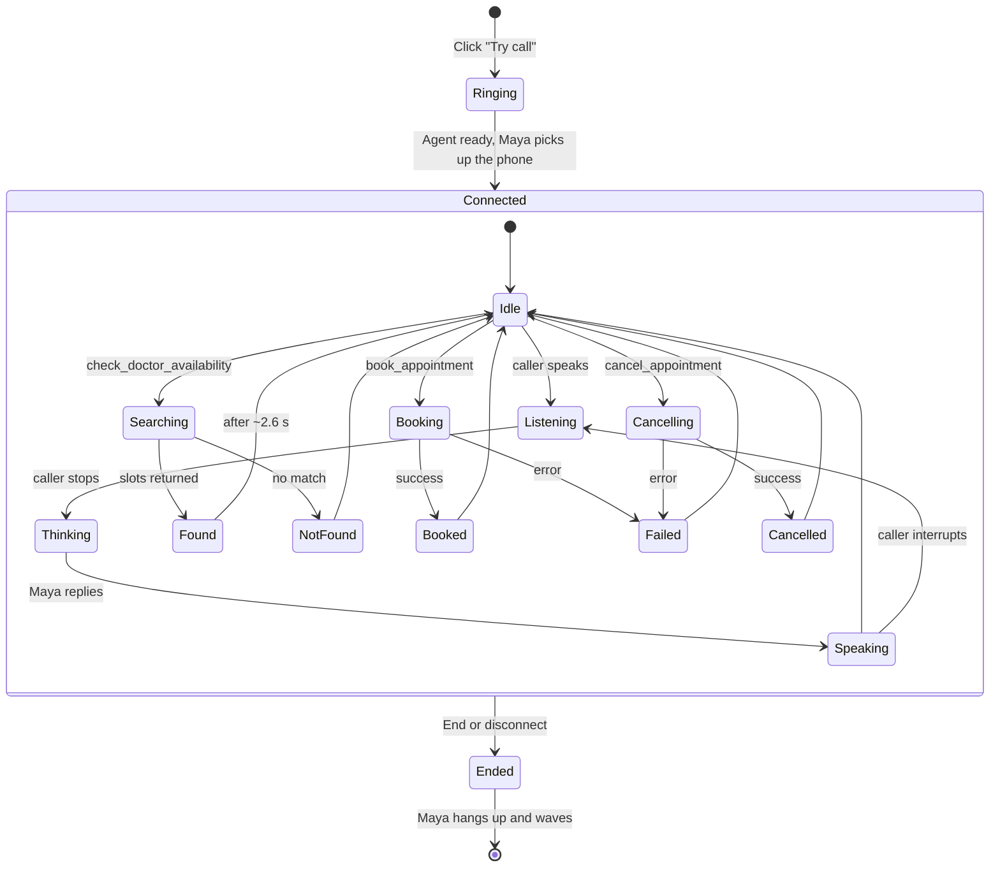

# Lumen Health · Voice Doctor Appointment Assistant

A caller talks to an AI receptionist, **Maya**, in the browser. Maya can check a doctor's availability, **book** an appointment and **cancel** one, all in a single natural conversation. The caller is identified **only by the phone number they say out loud** (no login, no OTP, no caller-ID), and Maya reads the number back for confirmation before booking or cancelling.

A web dashboard runs the call and shows what is happening: doctors and slots, a live appointments list, a live transcript, and an animated receptionist who reacts to the conversation.

| | |
|---|---|
| **Voice framework** | [Pipecat](https://github.com/pipecat-ai/pipecat) (Python) 1.17 |
| **LLM** | Google **Gemini** (`gemini-3.5-flash-lite` by default, free tier) with function calling |
| **STT / TTS** | ElevenLabs realtime speech-to-text and text-to-speech |
| **VAD** | Silero |
| **Transport** | WebRTC (Pipecat `SmallWebRTC`) |
| **Backend** | FastAPI + Uvicorn, in-memory mock data (seeded from JSON) |
| **Frontend** | React 18 + Vite, `@pipecat-ai/client-js` |

---

## Contents

1. [Architecture](#architecture)
2. [User flow](#user-flow)
3. [How it works](#how-it-works)
4. [Frontend](#frontend)
5. [Run it](#run-it)
6. [Configuration](#configuration)
7. [API](#api)
8. [Project structure](#project-structure)
9. [Design decisions](#design-decisions)
10. [Troubleshooting](#troubleshooting)
11. [Limitations](#limitations)

---

## Architecture



**Two channels reach the browser, for two different jobs:**

| Channel | Carries | Why |
|---|---|---|
| **WebRTC** (audio + data channel) | Caller audio up, Maya's audio down, live transcript and audio levels (Pipecat RTVI) | Low-latency, bidirectional, interruptible speech |
| **Server-Sent Events** | `booked`, `cancelled` and tool-stage events (`check` / `book` / `cancel` → `working` / `done` / `failed`) | Keeps the dashboard and the call animation in sync with what the tools actually did |

### The voice pipeline

```
browser mic ─WebRTC─▶ Silero VAD ─▶ ElevenLabs STT ─▶ Gemini (3 tools) ─▶ ElevenLabs TTS ─WebRTC─▶ browser speaker
```

| Stage | Component | Role |
|---|---|---|
| 1 | `SmallWebRTCTransport` | Receives caller audio, sends Maya's audio |
| 2 | `SileroVADAnalyzer` (`stop_secs=0.6`) | Detects when the caller starts and stops speaking; enables interruptions |
| 3 | `ElevenLabsRealtimeSTTService` | Streaming speech-to-text |
| 4 | `LLMContextAggregatorPair` (user) | Builds the conversation context for the LLM |
| 5 | `GoogleLLMService` | Gemini with the three tools registered for function calling |
| 6 | `ElevenLabsTTSService` | Text-to-speech, streamed back as audio |
| 7 | `LLMContextAggregatorPair` (assistant) | Records what Maya actually said into the context |

---

## User flow

### A full conversation



### Decision flow inside a call



### How the call screen reacts



---

## How it works

### Tools (function calling)

Registered on the LLM service inside the Pipecat pipeline (`backend/bot.py`):

| Tool | Arguments | What it does |
|---|---|---|
| `check_doctor_availability` | `doctor?` (name or speciality), `date?` (`YYYY-MM-DD`) | Returns open slots, grouped by doctor. With no filters it returns every doctor. Returns an error plus the roster when nothing matches. |
| `book_appointment` | `slot_id`, `phone_number`, `phone_confirmed`, `patient_name?` | Books the slot for that phone number. |
| `cancel_appointment` | `phone_number`, `phone_confirmed` | Cancels the confirmed appointment for that phone number and frees the slot. |

### Rules enforced in code, not only in the prompt

- **Read-back before acting.** `book_appointment` and `cancel_appointment` reject the call unless `phone_confirmed` is `true`. The model sets that flag only after the caller says yes to the read-back.
- **One confirmed appointment per phone number.** A second booking is refused with a clear message; the caller must cancel first.
- **No double booking.** Booking runs under a lock; a slot taken a moment earlier returns "slot was just taken" so Maya can offer another.
- **Phone normalisation.** `98765 43210`, `98765-43210` and `9876543210` are the same caller. Numbers shorter than 7 digits are rejected.
- **No past slots.** Slots earlier than "now" are never generated.

### Edge cases Maya handles

- **Vague request** ("I need a doctor"): asks which speciality instead of guessing.
- **Speciality or doctor we don't have** (e.g. plastic surgery): the prompt requires checking the roster first. If nothing matches, she says the team will confirm availability and get back to the caller, asks for their number, and offers the doctors that are available.
- **Unclear or garbled speech**: asks gently ("Sorry, did you say Dr. Nair?") rather than acting on a guess.
- **Tool errors**: explains simply and offers the next best step.
- **Out-of-scope requests** (medical advice, billing): politely declines.
- **LLM outage or rate limit**: instead of going silent, Maya says she is busy or lost the caller for a moment and asks them to repeat. The two cases use different wording, and the fallback is throttled to once every 8 seconds.
- **One search per question**: the prompt tells the model not to fan out parallel availability calls, which saves free-tier quota.

### Mock data

`backend/data/doctors.json` defines five doctors (Cardiology, Dermatology, Pediatrics, Orthopedics, General Medicine). On start, `store.py` generates slots for the next five working days (Mon–Sat), eleven times a day, with a deterministic "already taken" pattern so each doctor looks realistic. Everything lives in memory; **Reset** on the dashboard (or `POST /api/reset`) restores it.

### Live updates

`store.py` publishes events whenever data changes or a tool runs. `GET /api/events` streams them as Server-Sent Events; the dashboard refetches data on `booked` / `cancelled`, and the call screen turns tool events into stage animations.

---

## Frontend

React 18 + Vite. Key pieces in `frontend/src/`:

| File | Responsibility |
|---|---|
| `useCall.js` | Owns the Pipecat client: connect/disconnect, mute, timer, transcript, audio levels, call phases, and the tool-stage state machine (keeps each "working" stage visible for at least 1.5 s so it is readable). |
| `useData.js` | Fetches doctors and appointments, subscribes to SSE, drives the row highlights. |
| `Phone.jsx` | The call screen: header, scene, status line, controls, transcript panel, confirmation card. |
| `Character.jsx` | Maya, a hand-built SVG scene animated by a `requestAnimationFrame` loop that writes attributes directly (no React re-renders). |
| `sounds.js` | Ring, connect and hang-up tones synthesised with WebAudio, so there are no audio assets. |
| `App.jsx` | Dashboard layout: doctors by day, appointments, header. |

### Maya's animations

Her pose is derived each frame from the call phase, the current tool stage and the live audio levels:

| Moment | What you see |
|---|---|
| Ringing | Desk phone shakes, ring waves pulse |
| Connected | She picks up the handset and holds it to her ear |
| Maya speaking | Mouth follows the real voice level, slight head bob |
| Caller speaking | She tilts her head and raises her brows |
| Thinking | Eyes drift up and to the side |
| Checking availability | Looks at the monitor, types, scan bar sweeps the slot list; doctor slots on the dashboard shimmer |
| Doctor found | Happy eyes, blush, tick on the screen, confetti |
| Not found | Mild frown, "?" on the screen |
| Booking / booked | Types, then a calendar fills in with a tick and confetti |
| Cancelling / cancelled | Types, then a red cross on the calendar, a gentle sympathetic look |
| Call ended | Puts the handset down and waves |

Other touches: a plain-text transcript panel on demand (with an unread dot), a booking/cancellation card over the desk, green and red row highlights on the dashboard, a full-screen call layout on mobile, and reduced-motion support.

**Preview without a call:** run the frontend and open `http://localhost:5173/preview.html` for a gallery of every state, or `preview.html?phone=1&stage=book:done&card=booked` for the full call screen.

---

## Run it

**Prerequisites:** Python 3.12, Node 20+, an [ElevenLabs](https://elevenlabs.io) API key and a [Google AI Studio](https://aistudio.google.com) (Gemini) API key.

```bash
# 1. Backend
cd backend
python -m venv .venv
.venv\Scripts\activate            # macOS/Linux: source .venv/bin/activate
pip install -r requirements.txt
cp .env.example .env              # then add ELEVENLABS_API_KEY and GOOGLE_API_KEY
python server.py                  # http://localhost:7860

# 2. Frontend (second terminal)
cd frontend
npm install
npm run dev                       # http://localhost:5173  (proxies /api to :7860)
```

Open the dashboard in **Chrome**, allow the microphone and click **Try call**. Use **Reset** between demo takes.

> **Keys go in `backend/.env`** (git-ignored). `backend/.env.example` is a template and must stay free of real keys.

### Try saying

- "I'd like to see a cardiologist tomorrow morning." → availability, then a booking
- "My number is 98765 43210." → read-back and confirmation
- "Cancel my appointment." → read-back, then cancellation
- "Do you have a plastic surgeon?" → the roster check and "we'll get back to you" path

---

## Configuration

`backend/.env`:

| Variable | Default | Notes |
|---|---|---|
| `ELEVENLABS_API_KEY` | required | Needs text-to-speech and speech-to-text permissions |
| `GOOGLE_API_KEY` | required | Gemini key |
| `GEMINI_MODEL` | `gemini-3.5-flash-lite` | See Troubleshooting for free-tier limits |
| `ELEVENLABS_VOICE_ID` | `EXAVITQu4vr4xnSDxMaL` (Sarah) | Must be a *premade* voice on a free ElevenLabs plan |
| `PORT` | `7860` | Backend port |
| `CORS_ORIGINS` | `http://localhost:5173,http://localhost:3000` | Comma-separated |

---

## API

| Endpoint | Purpose |
|---|---|
| `POST` / `PATCH /api/offer` | WebRTC signalling (Pipecat SmallWebRTC); starts a pipeline per call |
| `GET /api/doctors` | Doctors with all their slots (`booked_by` is `null` when free) |
| `GET /api/appointments` | Appointments, newest first |
| `GET /api/events` | SSE stream: `{type: "booked" \| "cancelled", appointment, slot_id}` and `{type: "tool", name: "check" \| "book" \| "cancel", status: "working" \| "done" \| "failed"}` |
| `POST /api/reset` | Re-seed the mock data |
| `GET /api/health` | Liveness check |

---

## Project structure

```
.
├── README.md
├── backend/
│   ├── server.py            # FastAPI: WebRTC signalling, REST, SSE
│   ├── bot.py               # Pipecat pipeline, system prompt, tool schemas + handlers
│   ├── store.py             # In-memory doctors/slots/appointments, pub/sub for SSE
│   ├── data/doctors.json    # Mock doctors
│   ├── requirements.txt
│   └── .env.example
└── frontend/
    ├── index.html
    ├── preview.html         # Dev gallery of Maya's states
    ├── vite.config.js       # Dev proxy: /api -> :7860
    └── src/
        ├── App.jsx          # Dashboard
        ├── Phone.jsx        # Call screen
        ├── Character.jsx    # Animated receptionist (SVG)
        ├── useCall.js       # Pipecat client + call/stage state
        ├── useData.js       # REST + SSE data
        ├── sounds.js        # WebAudio ring/connect/end tones
        ├── styles.css       # Dashboard styles
        ├── call.css         # Call screen styles
        └── preview.jsx      # Gallery entry (dev only)
```

---

## Design decisions

- **Phone number as identity, enforced in code.** The model can forget to confirm; the tools refuse to act without `phone_confirmed`.
- **Tool stages over SSE, not inferred.** The animation follows what the tools actually did, including failures, instead of guessing from the audio.
- **Mouth driven by real audio levels.** The remote audio level reported by the Pipecat client moves her mouth, so it stays in sync even when speech is interrupted.
- **Direct DOM writes for the animation.** Audio levels change every frame; routing them through React state would re-render constantly.
- **Gemini Flash-Lite.** Fast enough for voice and tolerant of the free tier, with thinking set to `minimal` to keep replies quick.
- **A spoken fallback on LLM failure.** A silent agent feels broken; a short apology and a retry prompt does not.
- **Illustration as SVG.** No image or video assets, so it scales cleanly, stays small and can react to live data.

---

## Troubleshooting

| Symptom | Cause and fix |
|---|---|
| Maya says "I'm a little busy right now" or "I lost you for a moment" repeatedly | The LLM is failing. Check the backend log for `429` (free-tier quota, per minute or per day) or `503` (model overloaded). Free-tier daily caps can be as low as 20 requests per model; try a different `GEMINI_MODEL`, wait for the reset, or use a billing-enabled key. |
| No voice from Maya | Hard-refresh the page, allow audio, and check the log for TTS errors. On a free ElevenLabs plan, library voices return HTTP 402; use a premade voice ID. |
| `Microphone blocked` on the call screen | Allow microphone access for `localhost` in the browser. |
| Dashboard shows "Backend offline" | The backend is not running on port 7860. |
| Transcript is empty | The call needs a connected agent; check the backend log for a `client connected` line. |

---

## Limitations

- Data is **in memory** and shared by all calls on the server; restarting resets it. There is no database or authentication, by design for this exercise.
- Appointment "callbacks" for unknown specialities are **spoken only**; nothing is stored.
- Free-tier LLM and TTS quotas can interrupt long demo sessions.
- Tested with Chrome. WebRTC and microphone permissions behave differently in other browsers.
